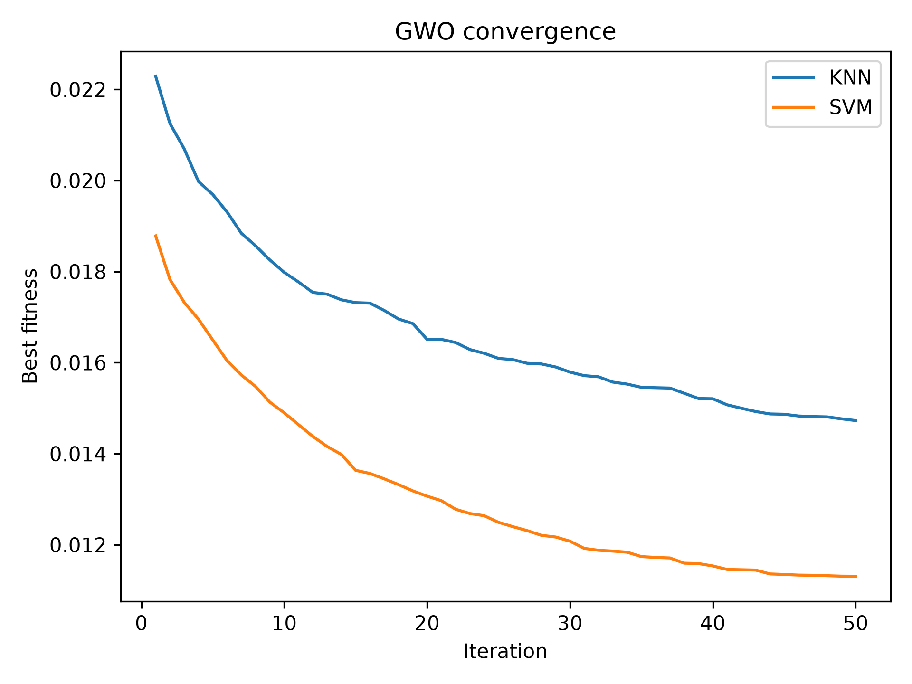
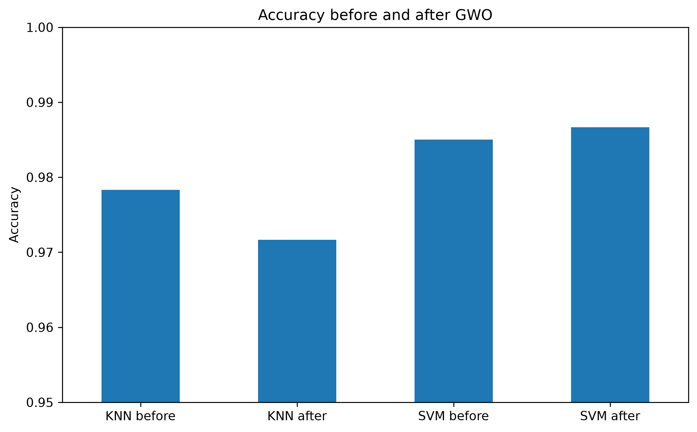
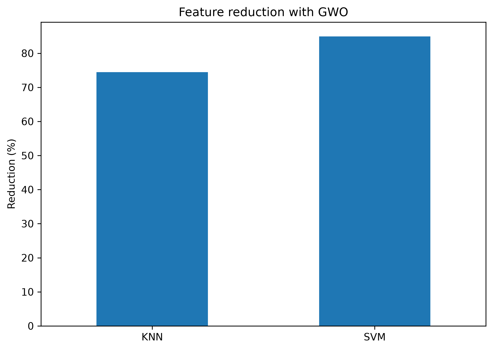

# Grey Wolf Optimizer for Feature Selection

**A reproducible machine learning experiment comparing KNN and SVM before and after Grey Wolf Optimizer (GWO) feature selection.**


## Overview

High-dimensional datasets can contain redundant or uninformative features that increase computational cost without improving predictive performance. This project investigates **wrapper-based feature selection** using the **Grey Wolf Optimizer**, a population-based metaheuristic inspired by grey wolves' social hierarchy and cooperative hunting behavior.

GWO searches for a subset of input features that balances **classification accuracy** against **feature count**. The resulting feature subsets are assessed with two classical machine learning models:

- **K-Nearest Neighbors (KNN)** with `n_neighbors=5`
- **Support Vector Machine (SVM)** with scikit-learn's default `SVC` configuration

The evaluation compares the full-feature baselines with the GWO-selected subsets using predictive performance, training and prediction time, and Python-level peak memory allocation.

## Dataset

The project uses the [Multiple Features (MFeat) dataset](https://archive.ics.uci.edu/dataset/72/multiple+features) from the UCI Machine Learning Repository. Six complementary feature groups are concatenated into one feature matrix.

| Property | Value |
| --- | ---: |
| Samples | 2,000 |
| Classes | 10 |
| Samples per class | 200 |
| Original features | 649 |
| Training set | 1,400 samples (70%) |
| Test set | 600 samples (30%) |
| Split | Stratified, `random_state=42` |

The preprocessing script expects these original files under `data/`: `mfeat-fac`, `mfeat-fou`, `mfeat-kar`, `mfeat-mor`, `mfeat-pix`, and `mfeat-zer`. It concatenates the feature groups and saves the train/test split to `data/data.npz`.

> **Evaluation protocol:** GWO selects features using cross-validation on the training set. The held-out test set is reserved for reporting final before/after classification metrics.

## Methodology

### 1. Baseline classification

KNN and SVM are fitted on all 649 features. Each classifier is wrapped in a scikit-learn pipeline with `StandardScaler`, so scaling is fitted on the appropriate training data. The project records accuracy, macro precision, macro recall, macro F1-score, average fit/prediction times over 10 repetitions, and peak Python memory allocation reported by `tracemalloc`.

### 2. GWO feature selection

A candidate wolf is represented by a continuous vector of 649 values in `[0, 1]`. Features with position values greater than `0.5` are selected. The three highest-performing wolves (alpha, beta, and delta) guide position updates, while the exploration parameter decreases throughout the search.

For a candidate subset \(S\), the objective minimized by the implementation is:

\[
F(S) = 0.99\,(1 - \operatorname{Accuracy}_{CV}(S)) + 0.01\,\frac{|S|}{649}
\]

where `Accuracy_CV` is the mean accuracy from five-fold stratified cross-validation on the training set. An empty subset receives a fitness value of `1.0`.

| Parameter | Value |
| --- | ---: |
| Independent runs per classifier | 20 |
| Wolves per run | 20 |
| Iterations per run | 50 |
| Cross-validation | 5-fold stratified |
| Classification weight | 0.99 |
| Feature-count penalty | 0.01 |
| Feature-selection threshold | 0.5 |
| Parallel workers across runs | 2 |

The implementation also caches fitness evaluations of previously seen binary feature masks. Each classifier receives its own optimized subset.

### 3. Post-optimization evaluation

For each classifier, the subset from its **lowest-fitness run** is used to train and evaluate the model on the held-out test set. The comparison provides a consistent view of predictive quality, dimensionality reduction, and computational characteristics before and after selection.

## Project Structure

```text
GWO-/
├── data/                  # UCI feature files and generated train/test .npz
├── results/               # CSV reports, GWO JSON results and figures
├── 0_preprocessig.py      # Load feature groups and create stratified split
├── 1_train.py             # Evaluate KNN and SVM using all features
├── 2_gwo.py               # Run feature selection with GWO
├── 3_after_gwo.py         # Evaluate both classifiers after selection
├── 4_plots.py             # Produce comparison charts
├── requirements.txt       # Python dependencies
└── README.md
```

> The filename `0_preprocessig.py` is intentionally shown as it appears in the repository.

## Getting Started

### Prerequisites

- Python 3 and `pip`
- The six MFeat feature files in the `data/` directory (if not already present)

### Installation

```bash
git clone https://github.com/Ben10-L/GWO-.git
cd GWO-
python -m venv .venv
source .venv/bin/activate  # macOS / Linux
# Windows: .venv\Scripts\activate
pip install -r requirements.txt
```

### Run the complete experiment

Execute the scripts **in the following order** from the repository root:

```bash
python 0_preprocessig.py  # Preprocess and split data
python 1_train.py        # Baseline models
python 2_gwo.py          # GWO optimization (computationally intensive)
python 3_after_gwo.py    # Evaluation with selected features
python 4_plots.py        # Generate comparison figures
```

The GWO stage performs repeated cross-validated model fits and may take considerably longer than the other steps depending on hardware.

## Outputs and Visualizations

The pipeline writes experiment artifacts under `results/`:

| Output | Description |
| --- | --- |
| `baseline.csv` | Full-feature KNN and SVM evaluation |
| `gwo_KNN.json`, `gwo_SVM.json` | Best subset, subsets per run, fitness scores, and settings |
| `gwo_convergence.png` | Mean best-fitness trajectory across optimization runs |
| `comparison.csv` | Before/after evaluation for both classifiers |
| `fig_accuracy.png` | Test accuracy comparison |
| `fig_metrics.png` | Macro precision, recall, and F1-score |
| `fig_features.png` | Number of selected features |
| `fig_feature_reduction.png` | Percentage feature reduction |
| `fig_train_time.png` | Training-time comparison |
| `fig_predict_time.png` | Prediction-time comparison |
| `fig_memory.png` | `tracemalloc` peak-memory comparison |

### Optimization convergence



### Classification performance



### Feature reduction



*Figures are generated by running the pipeline. Actual performance and feature counts should be read from `results/comparison.csv`, rather than assumed in advance.*

## Interpretation and Limitations

- **Feature selection is a trade-off:** Fewer features do not necessarily imply higher test accuracy; examine both predictive metrics and dimensionality reduction.
- **Optimization has overhead:** Total GWO search time is distinct from model training and inference time measured after selecting features.
- **Memory is an approximation:** `tracemalloc` monitors Python memory allocations; it is not a complete measurement of operating-system process memory.
- **Stochastic optimization:** Results depend on the random seeds, dataset split, hyperparameters, and library versions.
- **No universal superiority claim:** This repository is an experimental comparison, not evidence that GWO always outperforms other feature-selection methods.

## Tech Stack

**Python · NumPy · pandas · scikit-learn · SciPy · Matplotlib · Joblib**

Additional packages are declared in `requirements.txt`.


## Repository

Developed as a practical study of **metaheuristic optimization for machine learning feature selection**.

**GitHub:** [Ben10-L/GWO-](https://github.com/Ben10-L/GWO-)
